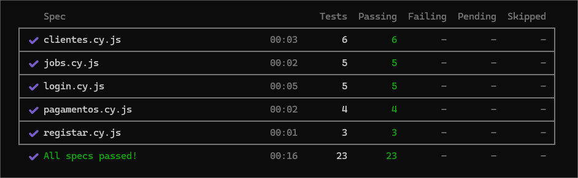

# Meu Freela Web: testes E2E com Cypress

[](https://github.com/abelkeveen/meu-freela-m2-web/actions/workflows/e2e.yml)


Aplicação web do **Meu Freela**, um sistema para freelancers organizarem clientes, jobs (trabalhos) e pagamentos, e a suíte de **testes end-to-end** que valida os fluxos do usuário no navegador.

Este repositório faz parte de um projeto de portfólio de QA em duas partes:

| Repositório | Conteúdo | Testes |
|---|---|---|
| [meu-freela-m2](https://github.com/abelkeveen/meu-freela-m2) | API REST (Node.js, Express, JWT) | 67 testes de API (Mocha, Chai e Supertest) e testes de performance (k6) |
| **meu-freela-m2-web** (este) | Aplicação web (HTML, JavaScript e Express) | 23 testes E2E (Cypress) |



## O que este projeto demonstra

- **Testes E2E com Cypress** cobrindo os fluxos principais (cadastro, login, clientes, jobs e pagamentos), incluindo cenários negativos e regras de negócio.
- **Testabilidade pensada junto com o código.** Todos os elementos usados nos testes têm `data-cy`, e os cards das listas têm `data-id`, para os testes não dependerem de texto, de CSS ou da ordem dos itens.
- **Preparação de dados pela API.** Comandos customizados criam usuário, cliente, job e pagamento direto na API, então cada teste exercita só a tela que está testando, fica mais rápido e não depende de outros testes.
- **Dados únicos por execução** (faker e timestamp), porque a API guarda tudo em memória e compartilha os dados entre os testes.
- **Integração contínua.** O GitHub Actions sobe a API e o app e roda a suíte inteira a cada PR e a cada push na `main`. Em caso de falha, os screenshots e os logs ficam salvos como artefato.
- **Bugs encontrados e corrigidos durante a automação.** Veja a seção [Bugs encontrados](#bugs-encontrados).

## Cobertura dos testes

| Spec | Cenários |
|---|---|
| `registar.cy.js` | cadastro com sucesso, login já existente, senha obrigatória |
| `login.cy.js` | login com sucesso, usuário inexistente, senha incorreta, logout, acesso ao dashboard sem login |
| `clientes.cy.js` | cadastrar, nome obrigatório, nome duplicado, editar, remover, bloqueio ao remover cliente com job |
| `jobs.cy.js` | cadastrar vinculado a cliente, campos obrigatórios, editar status, remover, bloqueio ao remover job com pagamento |
| `pagamentos.cy.js` | registrar pendente e conferir o total no resumo financeiro, registrar recebido, campos obrigatórios, marcar como recebido |

**Total: 23 testes, cerca de 16 segundos.**

## Como rodar

Pré-requisito: a [API](https://github.com/abelkeveen/meu-freela-m2) rodando em `http://localhost:3000`.

```bash
npm install
npm start          # app em http://localhost:4000
npm run cy:run     # testes em modo headless
npm run cy:open    # interface do Cypress
```

## Estratégia e organização

```
cypress/
├── e2e/                # um spec por funcionalidade
└── support/
    └── commands.js     # comandos customizados
```

| Comando | O que faz |
|---|---|
| `cy.openDashboard()` | cria um usuário pela API, faz login e abre o dashboard já autenticado |
| `cy.createClientByApi()`, `cy.createJobByApi()`, `cy.createPaymentByApi()` | preparam os dados do teste pela API |
| `cy.summaryByApi()` | consulta o resumo financeiro, para comparar com o valor exibido na tela |
| `cy.notification(texto)` | valida a notificação exibida no dashboard |
| `cy.createUser()` | cadastra um usuário pela tela de registro |

Exemplos de seletores: `[data-cy=new-client-btn]`, `[data-cy=client-nome]`, `[data-cy=client-card][data-id=3]`.

## Integração contínua

O workflow [`.github/workflows/e2e.yml`](.github/workflows/e2e.yml) roda a cada PR, a cada push na `main` e manualmente pela aba Actions. Ele:

1. baixa este repositório e a API ([meu-freela-m2](https://github.com/abelkeveen/meu-freela-m2));
2. sobe a API (porta 3000) e o app (porta 4000) e espera os dois responderem;
3. roda todos os specs com o `cypress-io/github-action`;
4. publica screenshots e logs da API e do app como artefato se algo falhar.

## Bugs encontrados

Problemas encontrados ao preparar o app para automação e corrigidos no [PR #1](https://github.com/abelkeveen/meu-freela-m2-web/pull/1):

| Bug | Impacto | Correção |
|---|---|---|
| O servidor lia a mensagem de erro no campo `message`, mas a API devolve `error` | O usuário via textos genéricos ("Erro ao criar cliente") em vez da regra que falhou | O servidor repassa o campo `error` da API |
| O select de clientes do modal de job às vezes era recarregado depois de o usuário escolher | O job não era salvo ("Todos os campos são obrigatórios") | A lista é buscada antes de preencher o select, e o modal só usa a lista pronta |
| Clientes e jobs criados depois de abrir a página não apareciam nos selects | Era preciso recarregar a página | As listas são sempre buscadas atualizadas |
| Textos vindos da API eram inseridos como HTML | Um nome como `` executava script na página (XSS) | O conteúdo é escapado antes de ser exibido |
| A data padrão dos formulários usava UTC | No Brasil, o horário aparecia 3 horas adiantado | Passou a usar o horário local |

Problemas conhecidos na API estão registrados nas [issues da API](https://github.com/abelkeveen/meu-freela-m2/issues).

## Sobre a aplicação

- **Front-end:** HTML, JavaScript e [Bulma](https://bulma.io/).
- **Servidor:** Express (porta 4000). Serve as páginas e repassa as chamadas `/api/*` para a API, enviando o token JWT.
- **Autenticação:** o token JWT fica no `localStorage` depois do login.

```
├── server.js           # servidor Express e repasse para a API
├── public/
│   ├── index.html      # login e cadastro
│   ├── dashboard.html  # dashboard (clientes, jobs e pagamentos)
│   └── dashboard.js    # lógica do dashboard
└── cypress/            # testes E2E
```

## Licença

ISC
